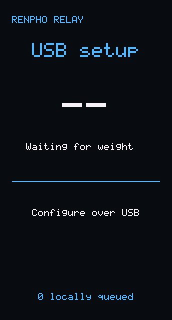
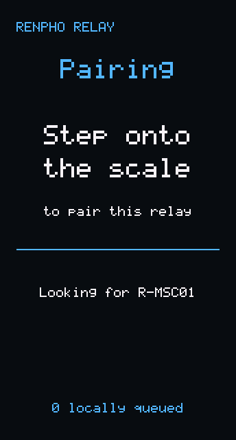
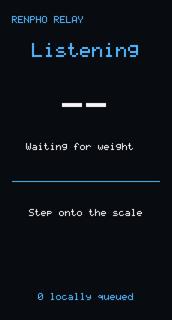
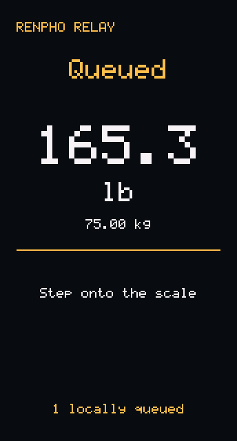
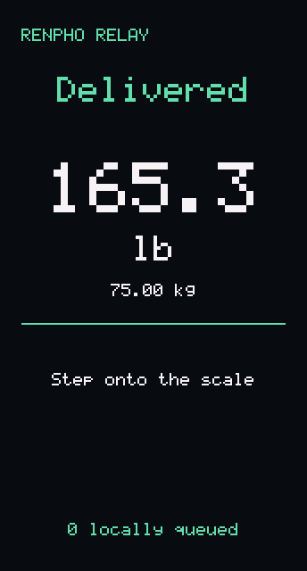
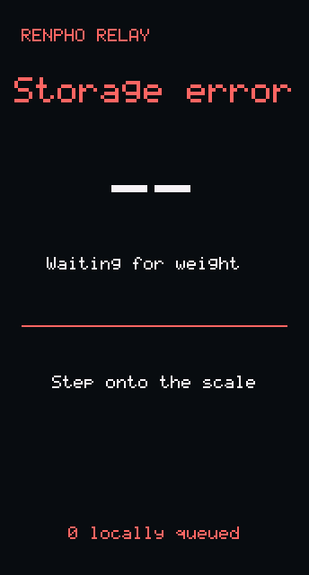

# RENPHO ESP32 relay

This project connects a RENPHO R-MSC01 scale to an HTTP receiver.
An ESP32 board gets scale data through Bluetooth Low Energy (BLE).
The relay saves a final measurement before it sends an acknowledgment to the scale.
It then sends the measurement through Wi-Fi.

The board shows weight in pounds and kilograms.
The relay keeps the original scale packets, not only the weight.
The repository includes a [reference receiver](#reference-receiver).
You can also use your own HTTP service.
The relay does not use the RENPHO cloud.

## Quick start

1. Start the [reference receiver](#reference-receiver), or use your own HTTP service with `POST /api/scale-readings`.
2. Connect the board to a computer with a USB data cable.
3. Open the [web installer](https://snrogers.github.io/renpho-esp32-relay/) in Chrome or Edge.
4. In the installer, back up the board, install the firmware, and enter your Wi-Fi network and receiver URL.
5. Step onto the scale. The relay pairs with the scale and sends the measurement to the receiver.

The installer needs no other software.
To install from a terminal instead, use `firmware/flash.py setup`, as given in the [firmware guide](firmware/README.md#guided-setup).
To record scale data with a computer, use the [computer tools](#computer-tools).

## Relay screens

The board LCD shows the relay state, the latest weight, and the number of queued records.
These images come from the firmware renderer. The weight is an example.

| USB setup | Pairing | Listening |
| :-------: | :-----: | :-------: |
|  |  |  |
| The relay has no configuration. | The relay has no scale address. Step onto the scale. | The relay waits for a measurement. |

| Queued | Delivered | Storage error |
| :----: | :-------: | :-----------: |
|  |  |  |
| A measurement waits in the outbox for delivery. | The receiver accepted the measurement. | The relay cannot use its flash storage. |

The [firmware guide](firmware/README.md#display-and-fault-checks) gives more data about these states.
After a change to `firmware/core/render.c`, run `firmware/host/screens.py` to make the images again.

## Select a guide

| Task                                 | Guide                                                           |
| ------------------------------------ | --------------------------------------------------------------- |
| Install the relay from a browser     | [Web installer](https://snrogers.github.io/renpho-esp32-relay/) |
| Install and configure the relay      | [Firmware guide](firmware/README.md)                            |
| Receive and view measurements        | [Reference receiver](#reference-receiver)                       |
| Record scale data with a computer    | [Computer tools](#computer-tools)                               |
| Calculate body-composition estimates | [Local calculations](#local-calculations)                       |
| Print and install a backplate        | [Backplate guide](cad/README.md)                                |

## Equipment and limits

| Item               | Specified equipment                               |
| ------------------ | ------------------------------------------------- |
| Scale              | RENPHO R-MSC01 MorphoScan                         |
| Bluetooth identity | Manufacturer `ICOMON`, model `FG2320ULB`          |
| Board              | Waveshare ESP32-S3-LCD-1.47, with 16 MB flash     |
| Firmware tools     | ESP-IDF v5.5.2, target `esp32s3`                  |
| Python tools       | Python 3.12 or a subsequent version, with `uv`    |
| Receiver           | `receiver.py`, or your HTTP service               |

Other RENPHO scales and the Waveshare 1.47B board are not verified.
The scale uses BLE, not Wi-Fi.
Only the board must connect to the Wi-Fi network.
The receiver can use a different network connection if the board can connect to it.

The relay does not calculate body-composition estimates or show them on the LCD.
The computer tools contain a local Python WLA37-compatible implementation.
With a complete user profile, they calculate estimates without the phone application, an APK, a native library, or Unicorn.

## Terms

| Term                 | Meaning                                                                     |
| -------------------- | --------------------------------------------------------------------------- |
| Acknowledgment (ACK) | A message that tells the sender that data arrived                           |
| BIA                  | Bioelectrical impedance analysis, which supplies body-composition estimates |
| Capture              | A file with scale packets and information about the recording session       |
| Final measurement    | A completed result, not a changing weight value                             |
| Outbox               | The records in board flash that wait for delivery                           |
| Packet               | A complete scale data message, after BLE frame assembly                     |
| Receiver             | The HTTP service that accepts measurements from the relay                   |
| Relay                | The firmware that operates on the ESP32 board                               |

## Data flow

```text
RENPHO scale --BLE--> ESP32 relay --HTTP(S)--> Receiver
                         |
                         +--> Local outbox and LCD

RENPHO scale --BLE--> Computer tools --> Capture file
                                             |
                                             +--> Replay or local calculations
```

The outbox has 16 record slots.
The relay can replace a delivered record to make space for a new measurement.
It does not replace an undelivered record to accept a new measurement.
The receiver must accept repeated requests without duplicate measurements.

Full recordings include device-information and measurement packets.
The measurement data includes weight and impedance channels.
The R-MSC01 has five impedance channels at each of two frequencies: 20 kHz and 100 kHz.

## Before you start

**WARNING:** Body-composition results are estimates, not medical diagnoses.
Do not use these results as a substitute for medical care.
Obey the scale manufacturer's safety instructions.

**CAUTION:** Firmware installation replaces the program on the board.
Save a complete flash backup before installation.
The [firmware guide](firmware/README.md#save-the-current-firmware) gives the backup procedure.

**CAUTION:** Captures and flash backups can contain personal measurements or Wi-Fi passwords.
Keep these files private.
Do not attach them to public issues or commits.

The firmware sends no HTTP authentication header.
Use a receiver and network that you control.
A plain HTTP connection does not encrypt measurements.
The firmware includes the ESP-IDF certificate bundle for HTTPS connections.

## Get the source

1. Install [Git](https://git-scm.com/downloads).
2. Install [uv](https://docs.astral.sh/uv/getting-started/installation/).
3. Copy the repository with this command:

   ```sh
   git clone https://github.com/snrogers/renpho-esp32-relay.git
   ```

4. Open the repository directory:

   ```sh
   cd renpho-esp32-relay
   ```

Start the commands in this guide from this directory.
`uv` reads the Python dependency versions from each script.

## Reference receiver

`receiver.py` accepts measurements from the relay and keeps them in a local SQLite file.
It uses only the Python standard library.
It records the time when each measurement arrives, because the relay has no clock.
It can also calculate body-composition estimates from the stored packets.

1. Start the receiver on a computer that the relay can reach on the network:

   ```sh
   uv run --python 3.12 --script receiver.py serve --port 8080
   ```

2. Set `receiverUrl` in the relay configuration to `http://COMPUTER_ADDRESS:8080`.
3. Open `http://COMPUTER_ADDRESS:8080/` in a browser to see the measurements.
4. To print the measurements in a terminal, use this command:

   ```sh
   uv run --python 3.12 --script receiver.py list
   ```

5. To calculate estimates, replace `AGE`, `HEIGHT_CM`, and `SEX` as in [Local calculations](#local-calculations):

   ```sh
   uv run --python 3.12 --script receiver.py report --age AGE --height-cm HEIGHT_CM --sex SEX
   ```

The default database is `readings.sqlite3` in the repository directory.
`--db` before the command selects a different file.
Git ignores `*.sqlite3` files.

**CAUTION:** The receiver has no authentication and listens on all network interfaces.
Use it only on a network that you control.
The database contains personal measurements. Keep it private.

A measurement that waited in the relay outbox gets the time of its delivery.
`GET /api/scale-readings` gives the stored measurements as JSON.

## Computer tools

The live recorder uses the computer's Bluetooth adapter.
The recorder checks the scale's manufacturer and model before it writes protocol data.
It does not write user profiles or firmware to the scale.
It saves history packets, but it does not acknowledge them.
Retention of that history on the scale is not verified.

Under WSL, Windows owns the Bluetooth adapter.
From WSL, use `./record.sh` instead of `uv run ... morphoscan.py record`.
It runs the recorder with Windows `uv.exe`, found on `PATH` or set in `UV_EXE`.

### Record one connection

1. Get the scale's BLE address with a Bluetooth scanner on the recording computer.
2. Make a `captures` directory in the repository.
3. Save this JSON as `captures/device.json`:

   ```json
   {
     "address": "AA:BB:CC:DD:EE:FF",
     "advertised_name": "example-scale"
   }
   ```

4. Replace `address` with the scale's address from step 1.
5. Replace `advertised_name` with the name from the scanner.
6. Disconnect the phone app from the scale.
7. Disconnect USB power from the ESP32 relay.
8. Activate the scale.
9. Start the recorder:

   ```sh
   uv run --python 3.12 --script morphoscan.py record --device captures/device.json --output captures/session.jsonl
   ```

10. Make sure that the terminal shows `Connected.`.
11. Use the scale as specified by its manufacturer.
12. Wait for the recording session to stop.
13. Connect USB power to the relay again.

The scan limit is 120 seconds.
A connection stops after 180 seconds or when the scale disconnects.
`--scan-seconds` and `--seconds` change these limits.
The recorder stops if the output path already has a file.
For the next recording, use a new output file name.

The recorder saves raw BLE notifications and decoded packets in JSON Lines (JSONL) format.
It saves a final measurement to disk before it sends the measurement ACK.
The recorder does not send measurements to the receiver.

### Read a saved capture

1. Decode the capture without Bluetooth:

   ```sh
   uv run --python 3.12 --script morphoscan.py replay captures/session.jsonl
   ```

2. Read weight and named impedance channels:

   ```sh
   uv run --python 3.12 --script morphoscan.py interpret captures/session.jsonl
   ```

Without profile values, `interpret` reports `profile_required`.
This mode labels measurements without calculating body-composition estimates.
The Python output uses kilograms, centimeters, and ohms where applicable.
Receiver software can convert these units for its display.

## Local calculations

The calculation tool contains a local Python implementation compatible with MorphoScan 1.9.8 / WLA37.
It does not require the phone application, an APK, a native library, or Unicorn.
Offline replay and interpretation use only the Python standard library.
Only live recording requires Bleak.

1. Select the profile values from the options table in this section.
2. Replace `AGE`, `HEIGHT_CM`, and `SEX` with those values.
3. Calculate estimates from the capture:

   ```sh
   uv run --python 3.12 --script morphoscan.py interpret captures/session.jsonl --age AGE --height-cm HEIGHT_CM --sex SEX --output captures/estimates.jsonl
   ```

| Option           | Permitted values                                 |
| ---------------- | ------------------------------------------------ |
| `--age`          | Whole years, 10 through 80                       |
| `--height-cm`    | Whole centimeters, 100 through 220               |
| `--sex`          | Vendor setting `female` or `male`                |
| `--athlete`      | Add this flag only for the vendor athlete mode   |
| `--bmi-standard` | `who`, `asia`, or `china`. The default is `who`. |

Age, height, and sex must be supplied together.
Use the person's age and height at the time of measurement.
Athlete mode is off unless you add `--athlete`.
The command stops if the estimates path already has a file.

The output includes body-fat estimates, water, muscle, bone, protein, metabolic rate, and results for five body segments.
Vendor thresholds are category limits, not medical recommendations.
Muscle, water, and protein quantities overlap.
Do not add these quantities together.
Segment percentages compare a segment with a vendor reference, not its tissue composition.

## Software checks

The protocol checks do not use Bluetooth or any vendor artifacts.

```sh
uv run --python 3.12 python -m unittest test_morphoscan_protocol test_flash_config test_flash_setup test_notice test_package_release test_receiver test_screens
make -C firmware/host
firmware/host/verify
node --test web/config.test.mjs
```

GitHub Actions runs these checks and compiles the firmware for each push to `main` and each pull request.

The calculation checks use complete inline reference measurements and results.
They do not require captures, an APK, a native library, or third-party packages.

```sh
uv run --python 3.12 python -m unittest test_morphoscan_body
```

These checks do not replace a hardware check.
The [backplate guide](cad/README.md) gives the limits of the geometry checks.

## Releases

A tag that starts with `v`, such as `v1.0.0`, makes a release.
GitHub Actions then attaches `renpho-relay-firmware-VERSION.zip` to a GitHub release.
It also publishes the web installer with that firmware to GitHub Pages.
Before the first release, set the repository Pages source to GitHub Actions.

## Publication and license

Git excludes `captures/`, `.vendor/`, APK files, native libraries, and firmware build output.
The ignored APK files and native libraries are not required to use the tools.
These rules do not remove files from Git history.
Keep configuration files with passwords outside the repository.

The [Unlicense](LICENSE) releases this repository into the public domain.
The monkey artwork and the backplate files that contain it are excluded.
You can print the engraved backplate for your own use.
No other use of the monkey artwork is permitted.
[NOTICE](NOTICE) lists these files and gives the full terms.
The repository does not grant a license for the vendor application or calculation library.

The guides use the writing rules and technical terms of [ASD-STE100 Issue 9](https://www.asd-ste100.org/).
No ASD certification is claimed.
