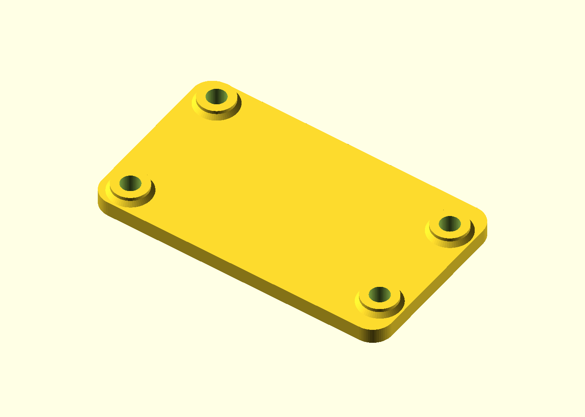
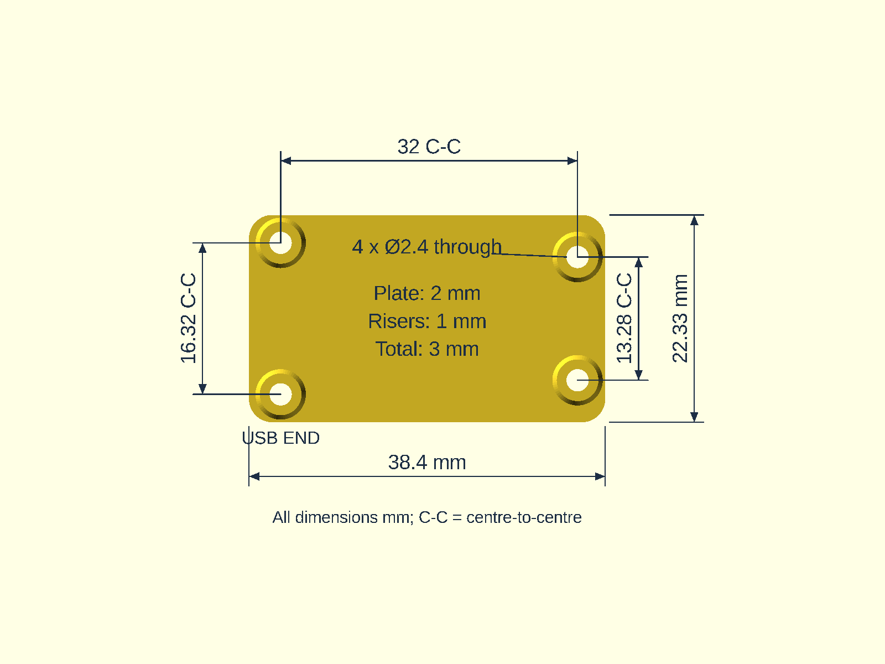

# ESP32 display backplate

This backplate is for the Waveshare ESP32-S3-LCD-1.47 board.
It uses the hole pattern from the manufacturer's structural drawing.
It is not for the 1.47B board or other revisions.
The backplate does not enclose all sides of the board.

[Project guide](../README.md) · [Firmware guide](../firmware/README.md)



## Terms

| Term          | Meaning                                                   |
| ------------- | --------------------------------------------------------- |
| Backplate     | Printed plate that attaches to the rear of the board      |
| Board         | Waveshare ESP32-S3-LCD-1.47 display module                |
| Mounting boss | Metal support on the rear of the board, with a screw hole |
| Riser         | Printed support around a hole in the backplate            |
| Underside     | Flat backplate face opposite the risers                   |

## Select a model

| File            | Plain backplate                         | Monkey engraving                                  |
| --------------- | --------------------------------------- | ------------------------------------------------- |
| Printable STL   | [Plain STL](esp32-backplate.stl)        | [Engraved STL](esp32-backplate-monkey.stl)        |
| Plated 3MF      | [Plain 3MF](esp32-backplate-plated.3mf) | [Engraved 3MF](esp32-backplate-monkey-plated.3mf) |
| OpenSCAD source | [Plain source](esp32-backplate.scad)    | [Engraved source](esp32-backplate-monkey.scad)    |
| Preview         | [Plain preview](esp32-backplate.png)    | [Engraved underside](esp32-backplate-monkey.png)  |

The 3MF files contain geometry, not slicer settings or G-code.
The engraved 3MF has one part at the center of a 250 mm by 210 mm bed.
Its center is at (125, 105) mm, with the underside at Z=0.
The engraved source uses the plain source and [monkey artwork](monkey-logo.svg).

**NOTE:** The monkey artwork and the engraved STL, 3MF, and preview are not under the Unlicense.
You can print the engraved backplate for your own use.
No other use of the monkey artwork is permitted, as given in [NOTICE](../NOTICE).
For a different engraving, put your own artwork in `monkey-logo.svg` and export again.

## Before you print

**CAUTION:** Physical board fit, screw threads, and usable thread depth have no physical verification.
A screw that is too long can damage the display.
Do not tighten a screw that does not turn freely in a mounting boss.
Do not cut threads into the assembled board.

The design assumes no soldered pin headers and no washers.
The 1 mm risers give 3 mm less clearance than the previous 4 mm risers.
Component clearance must be sufficient on the actual board.

### Dimensions

| Feature                           | Dimension           |
| --------------------------------- | ------------------- |
| Footprint                         | 38.4 mm by 22.33 mm |
| Plate thickness                   | 2.0 mm              |
| Riser height                      | 1.0 mm              |
| Total height                      | 3.0 mm              |
| Printed screw-hole diameter       | 2.4 mm              |
| Hole spacing at the USB end       | 16.32 mm            |
| Hole spacing at the opposite end  | 13.28 mm            |
| Distance between the hole columns | 32.00 mm            |



### Screws

The design uses four M2 × 5 mm pan-head machine screws, with standard M2 × 0.4 threads.
You can also use button-head screws with heads wider than the 2.4 mm holes.
The screw heads stay outside the flat underside.
The plate has no screw-head recesses.

1. Make sure that each board mounting boss accepts an M2 × 0.4 thread.
2. Measure the usable thread depth in each boss.
3. Make sure that the usable depth is 2.0 mm or more.
4. Measure screw length from below the head to the tip.
5. If these checks pass, select M2 × 5 mm screws.

**CAUTION:** Do not use countersunk screws or self-tapping screws.
Do not use a longer screw when an M2 × 5 mm screw does not fit.

| Length calculation                         | Dimension |
| ------------------------------------------ | --------- |
| Plate and riser                            | 3.0 mm    |
| M2 × 5 mm screw length below its head      | 5.0 mm    |
| Nominal screw engagement in the board boss | 2.0 mm    |

The [structural drawing](https://files.waveshare.com/wiki/ESP32-S3-LCD-1.47/ESP32-S3-LCD-1.47_Structural_Drawings.zip) identifies four 2.00 mm holes.
It does not specify an M2 thread or usable blind-hole depth.
M2 × 5 mm is the screw specification for this design, not a screw specification from the manufacturer.

An M2 × 6 mm screw has 3.0 mm of length outside the print.
The drawing shows a rear boss projection of only 2.5 mm.
Do not use M2 × 6 mm screws without a measurement of the actual usable depth.

## Print the backplate

| Setting               | Recommended value                         |
| --------------------- | ----------------------------------------- |
| Orientation           | Flat underside on the bed, with risers up |
| Material              | PLA or PETG                               |
| Layer height          | 0.2 mm                                    |
| Perimeters            | 3                                         |
| Top and bottom layers | 5 each                                    |
| Infill                | 20%                                       |
| Supports              | None                                      |
| Scale                 | 100%, with dimensions in millimeters      |

1. Open the selected STL or 3MF in your slicer.
2. Put the flat underside on the print bed.
3. Make sure that the risers point up.
4. Apply the settings in the table.
5. Examine the slicer preview.
6. Print the backplate.

### Monkey engraving

The monkey is on the exposed underside, not the board-facing surface.
The artwork is 18 mm high.
Its recess is 0.4 mm deep, with 1.6 mm of plate above the recess.
The mounting geometry and screw lengths are the same as the plain version.

The recess closes at Z=0.4 mm and makes short bridges.
The smallest artwork stroke is approximately 0.46 mm wide.
Small details and bridge quality have no physical verification.

1. Put the engraved face on the print bed.
2. Use a smooth print bed.
3. Use a nozzle with a diameter of 0.4 mm or less.
4. Examine the bridge layer at Z=0.4 mm in the slicer.

## Install the backplate

1. Disconnect USB power.
2. Remove loose print material.
3. Make sure that each screw moves freely through its printed hole.
4. Put the wider-spaced pair of risers at the USB end.
5. Put the four metal mounting bosses on the risers.
6. Make sure that the PCB, solder joints, and rear components do not touch the plate.
7. Put the screws through the underside, plate, and risers into the metal bosses.
8. Start all four screws by hand.
9. If a screw stops before the board is seated, stop the installation.
10. Tighten the screws only sufficiently to hold the board.
11. Make sure that the USB connector, the two buttons, and necessary card access stay clear.
12. Reconnect USB power.

**CAUTION:** Do not compress or bend the display assembly.
Do not continue if a screw binds or the board does not sit on all four risers.

## Examine or change the source

The models use plain OpenSCAD without BOSL2.
The engraved model uses `esp32-backplate.scad` and `monkey-logo.svg` from the same directory.

1. Install [OpenSCAD](https://openscad.org/downloads.html).
2. Open `esp32-backplate.scad` in OpenSCAD.
3. Push F5 for the preview.
4. Select Top View to see the dimensions.
5. Set `show_dimensions = false` if the dimension labels are not necessary.

The preview shows the dimension labels.
F6 renders and STL exports do not contain them.
The engraved source turns the part for an underside preview only.
Its exports keep the print orientation at Z=0.
`review_underside = false` selects the print orientation in the preview.
Preview color does not specify a different print material.

### Export an STL

These commands use OpenSCAD 2021.01 or a subsequent version with `openscad` on `PATH`.
Start from the `cad` directory.
These commands replace the two STL files in that directory.

```sh
openscad -q --hardwarnings --export-format asciistl -o esp32-backplate.stl esp32-backplate.scad
openscad -q --hardwarnings --export-format asciistl -o esp32-backplate-monkey.stl esp32-backplate-monkey.scad
```

### Limits of the geometry checks

The [verification script](verify-backplate.py) uses OpenSCAD skill helpers and an AppImage from the maintainer's computer.
Those helpers are not included in this repository.
The script is not a self-contained public test.

The checks examine these properties:

- One connected, watertight solid.
- Overall dimensions of 38.4 mm by 22.33 mm by 3.0 mm.
- Four clear paths for nominal 2 mm screw shanks.
- Interference when those paths move sideways by 0.5 mm.
- An open central clearance region on the board side.
- For the engraved part, an underside recess with material above Z=0.4 mm.

These checks do not prove physical fit, thread type, thread depth, or clearance for all rear components.
The actual board must pass the installation checks.
